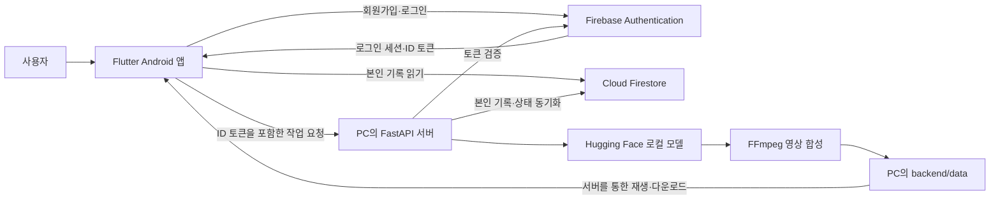
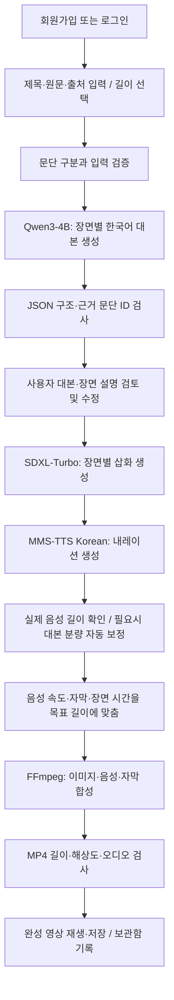
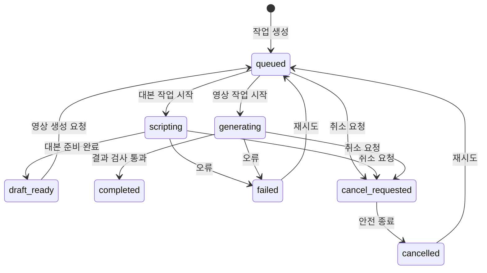

# 쇼토리 프로젝트 설명

**쇼토리(Shortory)**는 글이나 기사를 입력하면 대본, 삽화, 한국어 내레이션과 자막을 생성해 **30 / 45 / 60초 숏츠**로 만드는 Flutter Android 앱입니다. 프로젝트 저장소 이름은 `Shorts_Story`입니다.

## 개발 목적

텍스트 자료를 짧은 영상으로 만들려면 내용을 요약하고, 장면을 나누고, 이미지와 음성을 준비한 뒤 자막과 영상 길이를 맞춰야 합니다. 쇼토리는 이 과정을 하나의 앱 흐름으로 연결합니다. 사용자는 AI가 만든 대본과 장면 설명을 검토·수정한 후 영상을 생성하고, 자신의 보관함에서 결과를 확인할 수 있습니다.

## 주요 기능

| 기능 | 동작 |
|---|---|
| 회원가입·로그인 | 별도 영문 아이디와 비밀번호를 사용하고 Firebase Authentication으로 계정을 관리합니다. |
| 글 입력 | 제목, 원문, 출처와 목표 길이·스타일을 입력합니다. |
| 대본 생성 | 원문을 문단으로 나누고 Qwen3-4B가 장면별 내레이션, 제목, 이미지 설명과 근거 문단 ID를 만듭니다. |
| 대본 검토 | 사용자가 내레이션과 장면 설명을 확인하고 수정합니다. |
| 이미지·음성 생성 | SDXL-Turbo가 삽화를, MMS-TTS Korean이 한국어 음성을 생성합니다. |
| 영상 합성 | FFmpeg가 이미지 효과, 음성, 자막과 출처 화면을 합쳐 세로 MP4를 만듭니다. |
| 내 작업 | 현재 사용자의 제작 기록과 진행 상태를 보여줍니다. 완성된 영상은 재생·저장할 수 있습니다. |
| 연결 설정 | PC 서버 상태를 확인하고 에뮬레이터 또는 USB 연결 주소를 설정합니다. |

영문 아이디는 영문자로 시작하는 영문·숫자·밑줄 4~20자이며 대소문자를 구분하지 않습니다. 앱은 비밀번호를 8자 이상으로 제한합니다. 입력한 아이디는 내부 식별 주소로 변환해 Firebase의 비밀번호 인증을 사용합니다. 실제 이메일 주소를 수집하지 않으므로 이메일 비밀번호 찾기는 제공하지 않습니다.

## 과제 조건과 구현의 대응

| 과제 조건 | 쇼토리의 구현 |
|---|---|
| Hugging Face 등에서 AI 모델 확보 | Qwen3-4B, SDXL-Turbo, MMS-TTS Korean을 Hugging Face에서 다운로드합니다. |
| 로컬 기반 실행 환경 구축 | Windows PC에 Python 3.11·CUDA PyTorch 가상환경을 만들고 다운로드한 모델로 추론합니다. |
| 두 가지 이상의 모달리티 연계 | 텍스트에서 삽화와 음성을 생성하고, 이미지·음성·자막을 영상으로 합성합니다. 텍스트·이미지·음성·영상의 네 모달리티를 연결합니다. |
| 응용 서비스 설계·구현 | Flutter 앱, FastAPI 작업 서버, Firebase 인증과 사용자별 기록 저장을 연결합니다. |
| 필요에 따른 외부 API 연계 | Firebase 인증·Firestore 동기화에 외부 서비스를 사용합니다. 외부 AI 추론 API는 현재 사용하지 않습니다. |

생성형 동영상 모델을 직접 사용하는 방식은 아니며, 생성한 정지 이미지에 움직임 효과를 주고 음성과 자막을 합성하는 방식입니다.

## 시스템 구조

Android Studio에서는 Flutter 플러그인을 사용하고 화면·앱 기능은 Dart로 구현합니다. PC 서버와 AI 처리는 Python으로 구현합니다. Android 폴더의 Kotlin 파일은 Flutter 앱 실행을 위한 기본 네이티브 진입점입니다.

PC 서버는 기본적으로 `127.0.0.1:8765`에서 실행됩니다. 같은 PC의 Android 에뮬레이터는 `10.0.2.2:8765`로 접속합니다. 실제 Android 기기는 USB 디버깅과 `adb reverse`를 설정한 뒤 `127.0.0.1:8765`를 사용합니다. 저장소를 받은 사람은 자신의 PC 서버와 Firebase 프로젝트를 준비합니다.

## 콘텐츠 생성 흐름

장면 수는 목표 길이에 따라 30초 4개, 45초 6개, 60초 8개입니다. 음성 구절의 실제 재생 시간을 바탕으로 자막을 배치하고, 필요한 범위에서 음성 속도와 쉼을 조정합니다. 최종 결과는 **720×1280, 30fps, H.264 영상과 AAC 음성의 MP4**입니다. 각 장면에는 AI 생성 삽화 표시가 들어갑니다.

음성이 목표보다 크게 짧거나 길면 Qwen이 기존 장면 주제와 원문을 바탕으로 내레이션 분량을 자동 보정합니다. 이미지 설명과 장면 제목은 유지하고, 실제 음성을 다시 생성해 목표에 더 가까워진 경우에만 보정본을 사용합니다. 보정이 실패하거나 분량이 개선되지 않으면 기존 음성과 대본으로 계속 제작하며, 음성 속도와 장면 시간을 맞춥니다. 속도 조정은 FFmpeg가 처리할 수 있는 배율을 연결해 적용합니다.

근거 문단 ID와 구조 검사는 원문 검토를 돕는 장치입니다. AI가 작성한 문장의 사실 관계와 한국어 발음은 사용자의 검토가 필요합니다.

## 작업 상태와 장애 처리

앱은 작업 상태와 진행률을 확인합니다. PC 서버가 실행 중 작업을 중단하면 다음 시작 시 중단된 작업을 실패 상태로 표시하고 재시도를 안내합니다. Firestore 동기화 실패는 영상 생성 실패로 처리하지 않으며, 로컬 파일에 동기화 대기 정보를 남겨 연결 복구나 서버 재시작 후 재시도합니다.

## 사용자별 저장과 접근 제한

| 저장 위치 | 데이터 |
|---|---|
| Firebase Authentication | 계정, 비밀번호 인증, 로그인 세션 |
| `users/{uid}` | 아이디, 표시 이름, 갱신 시간 |
| `users/{uid}/shorts/{projectId}` | 제목, 원문·출처, 장면 대본, 목표 길이, 작업 상태와 결과 정보 |
| PC의 `backend/data/{projectId}/` | 작업 JSON, 이미지 PNG, 음성 WAV, 영상 MP4와 자막 SRT |

앱은 로그인한 사용자 자신의 Firestore 경로만 읽을 수 있습니다. 숏츠 기록은 검증된 PC 서버가 작성하며, 서버 API도 Firebase ID 토큰과 작업 소유자를 검사합니다. 비밀번호를 PC 서버나 Firestore에 저장하지 않습니다.

무료 구성을 위해 영상 파일은 PC에 저장합니다. Firebase Storage·Cloud Functions·유료 AI 추론 API를 사용하지 않습니다. PC 서버가 꺼져도 인터넷으로 DB의 기록 목록은 볼 수 있지만, 영상 생성·재생·다운로드에는 영상 파일이 있는 PC와 실행 중인 서버가 필요합니다.

## 소스 구성

| 경로 | 내용 |
|---|---|
| `lib/` | Flutter 화면, 인증, API 요청, 작업 모델, 영상 재생 |
| `backend/server.py` | 작업 API, 상태 관리, 로컬 저장과 동기화 |
| `backend/inference.py` | 대본·이미지·음성 모델 추론 |
| `backend/media.py` | 음성 시간 처리, 자막과 영상 합성 |
| `backend/domain.py` | 입력·장면 검증과 시간 배분 |
| `backend/firebase_service.py` | ID 토큰 검증, Firestore 기록 작성 |
| `scripts/` | 설치, 개인 Firebase 연결, 서버 시작, USB 연결과 배포용 소스 추출 |
| `firestore.rules` | 사용자별 DB 읽기와 프로필 쓰기 제한 |
| `backend/tests/`, `test/` | Python·Flutter 자동 검사 |
| `docs/` | 프로젝트 설명, 설치 방법, 인증 구조와 검증 기록 |

실제 Firebase 설정·서버 개인키·가상환경·생성 영상은 GitHub에 포함하지 않습니다. 각 사용자가 설치 도구와 설정 예제로 자신의 실행 환경을 만듭니다.

## 구현 계획

1. 글 입력, 목표 길이 선택과 작업 화면을 설계합니다.
2. PC의 모델 실행 환경과 작업 API를 구성합니다.
3. 원문 기반 대본 생성·검토·수정 흐름을 연결합니다.
4. 이미지·한국어 음성·자막·MP4 합성 파이프라인을 연결합니다.
5. Firebase 회원가입·로그인과 사용자별 제작 기록을 연결합니다.
6. 취소·재시도·동기화 오류 처리, 재생·저장과 접근 제한을 확인합니다.
7. 다른 PC의 설치 과정과 문서를 정리하고 검증합니다.

위 항목은 현재 구현에 반영된 순서입니다. 기존 [실제 실행 검증](VERIFICATION.md)과 [새 환경 설치·빌드 검증](PORTABILITY.md)에 확인 결과를 기록했습니다. 실행 방법은 [Windows 설치 안내](INSTALL_WINDOWS.md)에서 확인할 수 있습니다.

현재 버전의 범위는 글 붙여넣기와 정지 이미지 기반 숏츠 제작입니다. 원문 URL 자동 수집, 배경음악, 음성 복제, 생성형 동영상 모델, 인터넷에서 함께 사용하는 서버 호스팅은 추가 구현 범위입니다.
