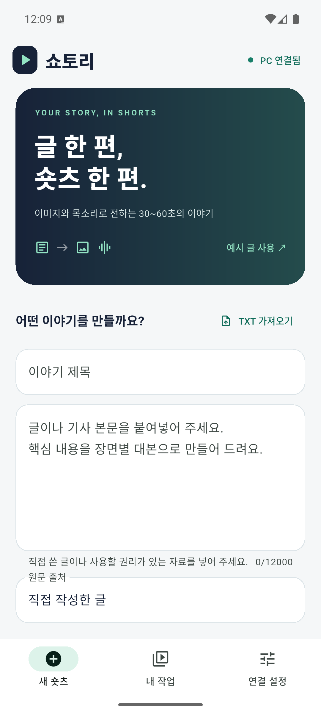
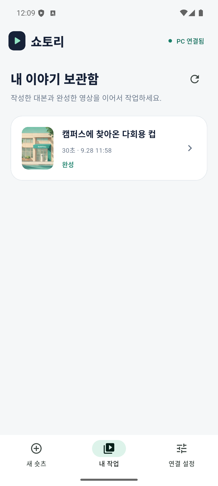
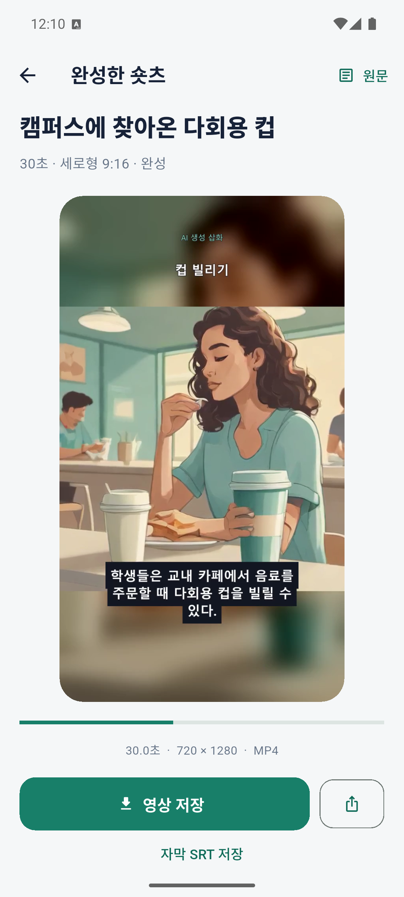
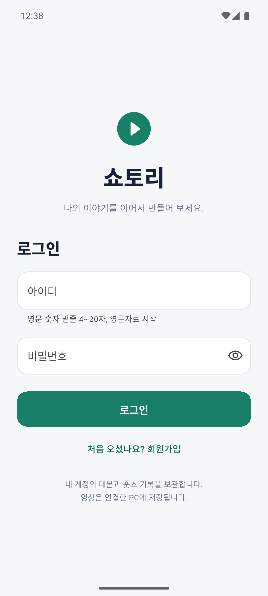
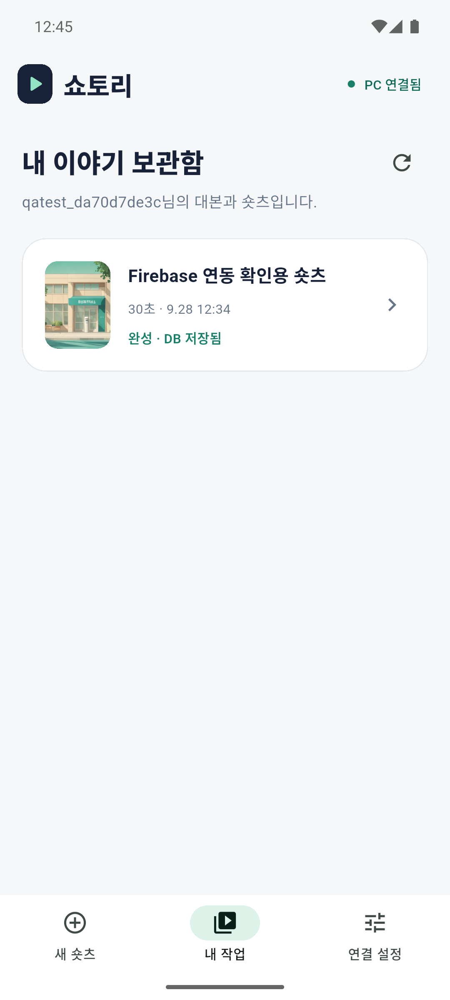
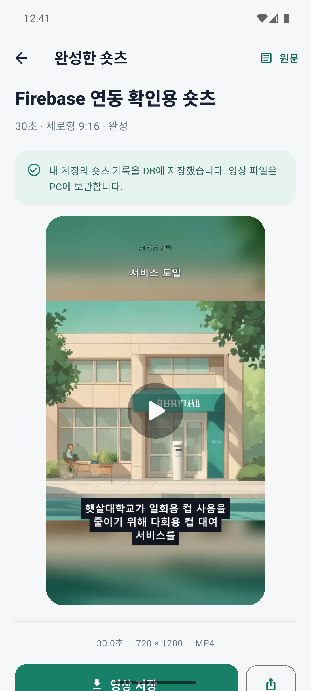

# 실행 및 검증 기록

확인일: 2026-09-28

## 환경

- Windows, Flutter 3.32 / Dart 3.8, Android Studio
- Android 36 전용 에뮬레이터 `Shortory` (x86_64)
- NVIDIA RTX 4060 Laptop GPU, VRAM 8GB, RAM 32GB
- Python 3.11, PyTorch 2.7.1 + CUDA 12.8, 로컬 FastAPI 서버
- 모델 리비전은 `backend/models.lock.json`에 고정
- 빌드 경로: `C:\Users\kim11\shortory_flutter` (원본 디렉터리의 junction)

## 자동 검사

| 검사 | 결과 | 범위 |
|---|---|---|
| `flutter analyze --no-pub` | 통과 | Dart 정적 분석 |
| `flutter test` | 6개 통과 | 서버 주소, 인증 헤더·토큰 재시도, 오류 표시, 아이디 정규화, 가입 확인 |
| `python -m pytest -q` | 12개 통과 | 입력/장면/시간 검증, 인증·소유자 검사, DB 동기화 실패·재시도·동시 변경 |
| Firestore 규칙 에뮬레이터 | 10개 통과 | 본인 읽기·프로필 쓰기 허용, 다른 계정·비로그인·클라이언트 숏츠 쓰기 차단 |
| `flutter build apk --debug` | 통과 | Android 디버그 APK 생성 및 전용 에뮬레이터 설치 |

## 최초 실제 생성 및 Android 실행

설명용 가상 기사 ‘캠퍼스에 찾아온 다회용 컵’을 사용했습니다. Qwen3-4B가 장면별 대본을 생성했고, 두 장면 제목과 한 이미지 설명을 검토·수정한 후 SDXL-Turbo 이미지와 MMS-TTS 한국어 음성을 실제로 생성했습니다. FFmpeg가 이를 세로 영상으로 합성했습니다.

- 작업 ID: `85fd087d3d17458b8ade3a6cbc1b48fc`
- 4개 장면, 5개 음성/자막 구절
- 영상: 720×1280, 30fps, H.264/AAC, 정확히 30.0초
- 파일 크기: 1,227,612바이트
- 음성 속도 보정: 1.0배
- 앱에서 PC 연결, 작업 목록, 완성 영상 재생 확인
- 영상의 HTTP Range 응답 `206 Partial Content` 확인
- 앱의 **영상 저장** → Android 시스템 저장창 → Downloads 저장 확인
- 에뮬레이터 저장 파일: `/sdcard/Download/쇼토리_85fd087d.mp4`
- 서버 원본과 Android 저장 파일의 SHA-256 일치:

```text
8ab13ac4c87f10531bcef42aa2744de1730fa71296deab7ee3f23c2838d12d02
```

결과물은 원본 작업의 `backend/data/<작업 ID>/shorts.mp4`에 있으며, 과제 폴더의 `output/쇼토리_30초_생성예시.mp4`에도 복사했습니다.

## 화면

| 글 입력 | 작업 보관함 | 영상 미리보기 |
|---|---|---|
|  |  |  |

[생성 영상의 실제 프레임](screenshots/video-frame.png)

## 확인 범위

실제 모델을 모두 연결한 생성·재생·저장 검증은 최초 예시와 Firebase 연동 예시를 합해 30초 예시 2건입니다. 45초·60초 전체 생성, 실제 안드로이드 기기, 다른 GPU, Android 공유 대상 앱별 전송은 별도로 확인하지 않았습니다. 한국어 발음, 원문 사실, 생성 이미지의 적절성은 대본과 미리보기에서 검토해야 합니다. 근거 문단 ID 검사는 자동 사실 검증을 의미하지 않습니다.

## Firebase 연동 검증

같은 날 쇼토리 전용 프로젝트 `shortory-kim11-20260928`에 Authentication 비밀번호 인증과 서울 리전 Firestore를 연결했습니다. 서비스 계정의 역할은 Firestore 데이터 접근과 Authentication 조회만 허용합니다. 결제 조회 결과는 `billingEnabled=false`, 결제 계정 미연결입니다. Storage와 외부 AI 유료 API를 사용하지 않습니다.

- 실제 Firebase REST API: 테스트 회원 두 명 가입, 중복 아이디 거부, 잘못된 비밀번호 거부, 정상 로그인 확인
- 실제 PC API: Firebase ID 토큰 검증, 인증 없는 요청 `401`, 다른 계정의 조회·편집·생성·취소·동기화·영상 요청 `404`
- 소유자 UID를 요청 본문에 위조해도 실제 로그인한 계정으로만 작업 생성
- 실제 Firestore: 본인의 숏츠 문서 조회 `200`, 다른 계정 및 비로그인 조회 `403`
- 영상 생성 완료 후 상태·대본·해상도·길이가 `users/{uid}/shorts/{projectId}`에 자동 반영됨
- Android: 두 계정으로 로그인·로그아웃, 첫 계정의 영상이 둘째 계정의 보관함에 나타나지 않음
- Android: 앱에서 세 번째 테스트 계정을 직접 회원가입하고 자동 로그인, 앱 프로세스 종료·재실행 후 로그인 유지 확인
- 세 계정의 회원 프로필이 Firestore에 기록되며 비밀번호와 인증 토큰 필드가 없는 것을 확인
- Android: 로그인한 소유자의 영상 재생과 시스템 저장창을 통한 MP4 저장, 서버와 저장 파일 SHA-256 일치
- APK 빌드 및 설치 성공. Firebase 의존성에 맞춰 Android 호스트 빌드 도구만 AGP 8.13.2 / Gradle 8.13 / Kotlin 2.3.10으로 조정했으며 앱 기능은 Dart로 구현

Firebase 검증용 작업 `9973da84d7fe4b6fa5b9a9ae2db65d5a`는 실제 Qwen3-4B → SDXL-Turbo → MMS-TTS → FFmpeg 흐름을 실행했습니다. 결과는 720×1280, 30fps, H.264/AAC, 1,190,586바이트, 30.005333초입니다. 오디오 패딩을 고려해 목표 30초와의 차이가 0.1초 이내인지 검사했습니다. 인증된 Range 요청은 `206`으로 응답했습니다.

| 로그인 | 사용자별 보관함 | DB 저장 완료·미리보기 |
|---|---|---|
|  |  |  |

[다른 계정의 빈 보관함](screenshots/firebase-other-account.png)

검증 후 이번 작업에서 만든 테스트 계정 3개와 해당 Firestore 기록만 삭제했습니다. 검증용 PC 작업 폴더는 과제 폴더의 `tmp/shortory_impl/firebase-qa/9973da84d7fe4b6fa5b9a9ae2db65d5a/`로 옮겨 보존했습니다. 임시 비밀번호·토큰 파일과 테스트 에뮬레이터를 정리하고, Android 앱은 로그아웃 화면에 두었습니다. 실제 PC AI 서버와 원래의 예시 영상은 유지합니다.

## 대본 길이 자동 조정 검증 · 2026-10-02

목표 60초 작업에서 한국어 음성 합계가 약 26초여서 영상 생성이 중단되는 문제를 수정했습니다. 대본 분량이 목표와 크게 다르면 원문을 바탕으로 자동 보정을 시도하고, 실제 음성 길이가 개선된 경우에만 보정본을 사용합니다. 보정이 실패하거나 개선되지 않아도 기존 음성과 대본으로 제작을 계속합니다.

짧은 음성은 속도를 0.85배까지 조정하고 남은 시간을 장면별 표시 시간으로 분배합니다. 긴 음성은 FFmpeg가 지원하는 속도 필터를 연결해 목표 길이에 맞춥니다. 대본이 짧거나 길다는 이유만으로 사용자에게 편집을 요구하는 실패를 반환하지 않습니다. 보정 음성은 별도 캐시에 생성해 실패 시 원래 음성을 유지합니다.

- 기존 실패 작업을 소유자 인증을 유지한 API 요청으로 다시 생성
- 최종 상태 `completed`, 오류 없음, Firestore 동기화 `synced`
- 최종 파일: **60.008초, 720×1280, 30fps, H.264/AAC**, 2,060,489바이트
- 기존 8개 AI 장면 이미지를 재사용하고 음성·자막·장면 시간을 조정
- Python 자동 검사 **38개 통과**: 길이 차이가 큰 대본, 잘못된 음성, 속도 필터, 보정 실패·취소·비개선 처리와 기존 인증·저장 검사
- 4.5배 속도 조정 필터로 실제 WAV를 생성해 FFmpeg 처리 확인

새 결과는 PC 서버와 DB에 반영했습니다. 이 추가 검증 시점에는 Android 에뮬레이터가 연결되어 있지 않아 새 영상의 기기 재생은 다시 검사하지 않았습니다. MP4의 영상·음성 스트림과 길이는 ffprobe로 확인했습니다.

## 미리보기 음량 조절 검증 · 2026-10-15

완성 영상 미리보기에 0~100% 음량 슬라이더와 음소거 버튼을 추가했습니다. 음소거를 해제하면 직전 음량을 복원하며, 선택값은 기기에 저장되어 다음 영상에서도 적용됩니다. 이 기능은 앱 재생 음량을 바꾸며 저장된 MP4의 음량은 변경하지 않습니다.

- `flutter analyze`: 오류 없음
- `flutter test`: 기존 검사와 음량 조작·저장·복원 검사를 합해 **8개 통과**
- `flutter build apk --debug`: 통과, 기존 앱 데이터를 유지하며 Shortory 에뮬레이터에 업데이트 설치
- 실제 앱에서 100% → 41% → 0% → 41% 복원 확인, 이후 100%로 설정하고 다른 완성 영상을 열어 유지 확인
- 기존 소비자신뢰·지뢰 기사 MP4의 AAC 음성 트랙과 디코딩 정상 확인
- 두 기존 영상을 앱에서 처음부터 재생하며 에뮬레이터 오디오 세션에 유효한 출력 신호가 있음을 확인

소비자신뢰 영상에는 짧은 대본을 목표 60초에 맞춰 장면을 유지하는 무음 구간이 있습니다. 앱 재생 음량 기능은 이 구간에 새 음성을 추가하지 않습니다.
